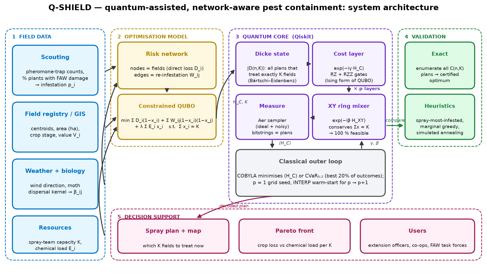
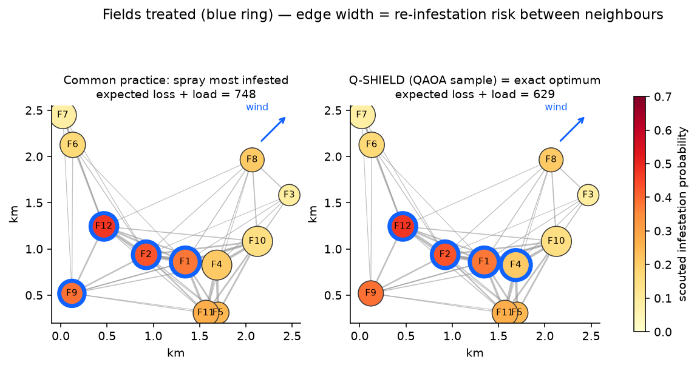
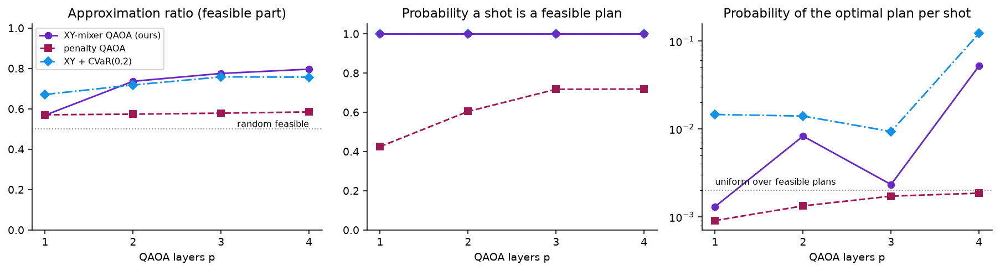

# Q-SHIELD: quantum-assisted, network-aware Fall Armyworm containment

**Report:** [Q-SHIELD_Report.docx](Q-SHIELD_Report.docx) · **Video pitch:** _link coming_

**Qiskit Fall Fest 2026 Hackathon · Domain 4: Agriculture**

A village spray team can treat only **K** of **n** infested maize fields before Fall Armyworm larvae become uncontrollable. Which fields should it treat?
The usual rule is "spray the worst fields first". That rule ignores something important: moths from untreated fields re-infest their neighbours.
Q-SHIELD turns this decision into a **constrained QUBO**. Its quadratic terms *are* the field-to-field re-infestation risk. We solve it with a **constraint-preserving QAOA** in Qiskit: a Dicke-state start plus an XY mixer, so every measured bitstring is a valid spray plan.



## Why this problem
- Fall Armyworm costs African maize USD 1–9.4 bn per year (CABI 2018/2021). By 2019 it had spread across Africa and to more than a dozen Asian countries.
- FAO's Global Action (65 countries) calls for **area-wide, coordinated** control, because moths fly 20–40 km per night.
- The users are extension officers, cooperatives and FAW task forces deciding where one sprayer or drone goes in a 72-hour window.

## Formulation
`x_i = 1` if field *i* is treated.

```
min f(x) = Σ_i D_i (1−x_i)                    direct loss  D_i = V_i p_i δ
         + Σ_{i<j} W_ij (1−x_i)(1−x_j)        re-infestation between untreated neighbours
         + λ Σ_i E_i x_i                       chemical load
s.t.     Σ_i x_i = K                           spray capacity
```
`W_ij = S_ij + S_ji` with `S_ij = p_i β_ij (1−p_j) V_j δ`, and `β_ij = β0·exp(−d_ij/L)·(1+0.6cos(θ_ij−θ_wind))`.

## Quantum method
| Piece | Qiskit implementation |
|---|---|
| Initial state | Dicke state \|D(n,K)⟩ (Bärtschi–Eidenbenz circuit, written from scratch and unit-tested) |
| Cost layer | `RZ` + `RZZ` from the Ising form of the QUBO |
| Mixer | parity-ordered ring of `XXPlusYYGate`, which conserves Σx = K |
| Optimiser | COBYLA on ⟨H_C⟩ (`Statevector`), p=1 grid seed, INTERP warm start for deeper p |
| Execution | `AerSimulator`, ideal and depolarising noise |
| Baselines | exact enumeration, spray-most-infested, marginal greedy, simulated annealing, penalty QAOA |

## Run it
```bash
python -m venv .venv
.venv\Scripts\activate          # Windows   (Linux/macOS: source .venv/bin/activate)
pip install -r requirements.txt
python tests/test_core.py        # 4 correctness checks (Dicke, QUBO, feasibility, exactness)
python run_demo.py --quick       # fast check (~3-4 min) -> results/quick/
python run_demo.py               # full results + all figures (~9 min) -> results/
python make_architecture.py      # architecture diagram
python build_report.py           # regenerates Q-SHIELD_Report.docx from results/summary.json
```
Everything is seeded, so reruns reproduce `results/summary.json`.

## Headline results (12 fields = 12 qubits, K = 4, 495 feasible plans)
See `results/summary.json` and `Q-SHIELD_Report.docx` for the full numbers.

| Method | Fields treated | Cost | vs optimum |
|---|---|---|---|
| Exact enumeration (495 plans) | F1, F2, F4, F12 | 628.9 | — |
| Spray most infested (current practice) | F1, F2, F9, F12 | 748.5 | **+19.0%** |
| **Q-SHIELD XY-QAOA, CVaR, p=4 (Aer, 4096 shots)** | F1, F2, F4, F12 | 628.9 | **optimal** |

| QAOA variant (p=4) | Feasible shots | Approx. ratio | P(optimal) per shot | vs uniform |
|---|---|---|---|---|
| Penalty QAOA (textbook) | 72% | 0.584 | 0.0019 | 0.9× |
| XY mixer + Dicke (mean energy) | 100% | 0.796 | 0.0521 | 25.8× |
| **XY mixer + Dicke + CVaR(0.2)** | **100%** | 0.757 | **0.1221** | **60.5×** |

- Optimal plan seen in **505/4096** shots; every shot is a feasible plan.
- Pareto sweep K = 2…6: the QAOA best sample matches the exact optimum for every K.
- 12 random villages: spray-most-infested is on average 7.6% worse (max 19.0%). With CVaR, QAOA amplifies the optimum by 19.2× on average (p=3), and the best-of-1024 shots is exact in 11 of 12 villages.




## Honest limitations
- **No quantum speed-up is claimed.** At this size, exact search is instant and classical heuristics also find the optimum.
- Per-shot probability of the optimum is amplified but stays at the percent level, so we report approximation ratio and amplification, not just "found the optimum".
- Noise breaks the XY mixer's feasibility guarantee. With post-selection, the amplification survives 0.1–0.3% two-qubit error but is gone by 1%.
- The spread model is a one-step, literature-calibrated synthetic model, not fitted to field data.

## Repository layout
```
qshield/instance.py    problem model, QUBO, Ising
qshield/quantum.py     Dicke state, XY-mixer QAOA, penalty QAOA, Aer sampling
qshield/classical.py   exact + heuristic baselines
run_demo.py            end-to-end experiment
tests/test_core.py     correctness tests
results/               figures + summary.json
```

## Credits
Algorithms: Farhi et al. 2014 (QAOA), Hadfield et al. 2019 (Quantum Alternating Operator Ansatz, XY mixers), Bärtschi & Eidenbenz 2019 (Dicke states), Zhou et al. 2020 (INTERP).
All code was written for this hackathon, with AI coding assistance (Claude). No tutorial or other teams' code was copied.
